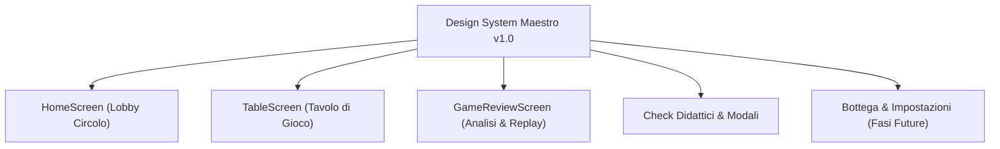

# Design System — Maestro UI

**Versione:** 1.0  
**Data:** 2026-10-24  
**Stato:** Trilogia Mockup Completata & Approvata da Michele  
**Schermate di Riferimento Ufficiali:**
1. [`reference_menu_screen.jpg`](reference_menu_screen.jpg) — Menù Iniziale / Lobby
2. [`reference_table_screen.jpg`](reference_table_screen.jpg) — Il Tavolo da Gioco
3. [`reference_review_screen.png`](reference_review_screen.png) — Game Review & Fine Partita

---

## 1. Visione e Obiettivi del Design System

Il Design System di **Maestro** ha l'obiettivo di garantire un'esperienza visiva e tattile coerente, immersiva e artigianale in tutte le schermate dell'applicazione.

### Principi Fondamentali
1. **Unico Ambiente Coeso:** Ogni schermata (Lobby, Tavolo di gioco, Game Review, Check didattici, Impostazioni, Bottega) deve dare al giocatore la sensazione di trovarsi all'interno dello stesso circolo italiano: legno caldo di noce, panno verde, finiture in ottone dorato e cartoncino bianco puro.
2. **Profondità Tattile (Skeuomorphic Leggero):** Elementi cliccabili con rilievi 3D morbidi, riflessi satinati e ombre accoglienti che invitano al tocco.
3. **Massima Leggibilità & Contrasto:** Testi scuri `#1A1A1A` su fondi caldi/avorio `#FDFBF7`, indici d'angolo chiari sulle carte e bollini color-coded immediati per la review didattica.
4. **Nessun Elemento Sci-Fi o Finto-AI:** Nessun neon blu elettrico, microchip o ologrammi. La tecnologia e l'AI restano "sotto il cofano"; l'esperienza visiva è calda, umana e tradizionale.

---

## 2. Token Fondamentali (`ui/theme`)

### 2.1. Palette Colori Semantica

```kotlin
// Superfici Principali
TableFeltGreenLight = Color(0xFF1E4D2B) // Verde centro tavolo (luce)
TableFeltGreenDark  = Color(0xFF14381E) // Verde bordi tavolo (vignettatura)
WoodSurfaceDark     = Color(0xFF3B2213) // Noce scuro per cornici e targhette
WoodSurfaceLight    = Color(0xFF5A3821) // Riflesso legno caldo
CardPaperWhite      = Color(0xFFFFFFFF) // Cartoncino bianco puro per le carte
CardIvorySurface    = Color(0xFFFDFBF7) // Carta avorio per dialoghi e modali

// Dettagli Metallici
BrassGold           = Color(0xFFD4AF37) // Ottone/oro per bordi e cornici
BrassGoldHighlight  = Color(0xFFFFE082) // Riflesso superiore satinato
BrassGoldShadow     = Color(0xFF8C6D1F) // Ombra inferiore metallica

// Bottoni Tattili
ButtonGreenTop      = Color(0xFF2E8B57) // Gioca / Azione primaria
ButtonGreenBottom   = Color(0xFF1F683D)
ButtonBlueTop       = Color(0xFF1E5A8A) // Palestra / Spiegazione didattica
ButtonBlueBottom    = Color(0xFF164366)
ButtonAmberTop      = Color(0xFFA05A2C) // Azioni secondarie / Nuova Partita
ButtonAmberBottom   = Color(0xFF7D3F19)

// Bollini Analizzatore (Game Review)
GradeMagistraleBlue = Color(0xFF1E88E5) // Mossa magistrale
GradeStandardGreen  = Color(0xFF43A047) // Mossa naturale / ottima
GradeInaccuracyYellow = Color(0xFFFBC02D) // Imprecisione
GradeMistakeRed     = Color(0xFFD32F2F) // Errore grave
```

### 2.2. Forme e Raggi di Curvatura (`Shapes`)
- **Pill (100% / 50.dp):** Tutti i bottoni d'azione primaria e secondaria (`MaestroPillButton`), pillole filtro nella review.
- **Plaque (10.dp – 14.dp):** Targhetta punteggio orizzontale, scomparti Noi/Voi, testate di sezione.
- **Dialogue Bubble (16.dp):** Box di dialogo del Maestro con coda verso l'avatar.
- **Card (8.dp):** Carte da gioco con angoli arrotondati e sottile bordo marcatore scuro.

---

## 3. Libreria dei Componenti Riusabili (`ui/components`)

| Componente | File Sorgente | Descrizione |
|---|---|---|
| `MaestroPillButton` | `TactileButtons.kt` | Pulsante a rilievo 3D con sfumatura verticale, riflesso satinato superiore, bordo dorato e ombra morbida. |
| `ScorePlaque` | `TactileButtons.kt` | Targhetta punteggio in legno noce con scomparti Noi (blu) e Voi (rosso). |
| `MaestroDialogueBox` | `TactileButtons.kt` | Fumetto del Maestro in cartoncino panna/avorio, bordo ottone, tipografia ad alto contrasto e slot per l'avatar. |
| `MoveQualityBadge` | `TactileButtons.kt` | Bollini colorati con icona e punteggio di classe mossa (Magistrale, Ottima, Imprecisione, Errore). |
| `MaestroAvatarView` | `MaestroAvatarView.kt` | Avatar in cornice circolare d'ottone con aureola dinamica per i 5 stati d'animo (`maestro_<mood>`). |
| `CardView` | `CardView.kt` | Resa della carta su cartoncino bianco con indici d'angolo, supporto per mazzo pluggabile (`DeckTheme`) e fallback vettoriale. |
| `FeltBackground` | `Theme.kt` | Sfondo a sfumatura radiale dal verde brillante centrale al verde scuro dei bordi con vignettatura. |

---

## 4. Tabella di Marcia per l'Applicazione alle Schermate



1. **`HomeScreen` (Lobby):**
   - Header in legno/ottone con benvenuto del Maestro e contatore monete/crediti.
   - Bottoni tattili: *"Gioca Subito"* (Verde primario con bordo dorato), *"Palestra del Maestro"* (Blu cobalto), *"Storico"* (Ambra/Legno).
2. **`TableScreen` (Tavolo):**
   - Panno verde radiale a tutto schermo con cornice perimetrale in noce scuro.
   - `ScorePlaque` posizionata in alto con punteggi in tempo reale.
   - Box compatto del Maestro con suggerimenti e domande dei Check a metà smazzata.
   - Mano del giocatore disposta a ventaglio ergonomico con zoom al tocco.
3. **`GameReviewScreen` (Rassegna Partita):**
   - Barra superiore con precisione % racchiusa in una targhetta dorata.
   - Timeline delle mani con i bollini colorati per identificare a colpo d'occhio i momenti chiave.
   - Spiegazione didattica del Maestro nel fumetto d'avorio.
4. **Modali e Dialoghi (Check, Pause, Impostazioni):**
   - Riquadro centrale su pergamena/carta avorio `#FDFBF7` con cornice sottile d'ottone, pulsanti di conferma verde e annulla ambra.
